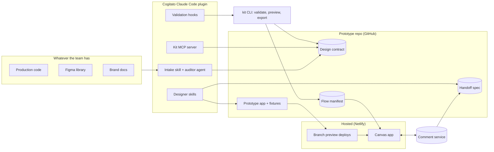

# Architecture Overview

Source: the "Designer–Developer Prototype Collaboration" doc. This file turns that concept into buildable pieces.

## What we're building

A system that lets a designer build real, coded prototypes with Claude Code on their own machine, constrained to their team's design system, and then review, annotate and hand those prototypes off to developers on a shared canvas.

Working name: **Cogitato**.

## Guiding principles

1. **The design contract is the center.** Every source (production code, Figma, brand docs) is converted into one contract. Everything downstream reads only the contract.
2. **State is addressable.** Every meaningful screen state is reachable by `route + fixture`. This is what makes the canvas possible.
3. **Enforce, don't ask.** Rules live in hooks and validators, not just in prompts.
4. **Designers never see the machinery.** No terminal, no git, no dev server management.
5. **Plain files, in git.** Contracts, fixtures, flows and specs are files in the prototype repo. Only live comments live in a service.
6. **Claude Code first, local only.** v1 targets teams with Claude and Claude Code, running locally in the desktop app. Hosting is separate (Netlify or similar).

## System map

## Components

| # | Component | Lives in | Brief |
|---|-----------|----------|-------|
| 1 | Design contract schema | `packages/contract` | [01-contract.md](components/01-contract.md) |
| 2 | Kit CLI (validator, preview, export) | `packages/kit-cli` | [02-kit-cli.md](components/02-kit-cli.md) |
| 3 | Prototype template + fixture system | `templates/workspace-react` | [03-prototype-template.md](components/03-prototype-template.md) |
| 4 | Claude Code plugin (skills, hooks, agents) | `plugin/` | [04-claude-plugin.md](components/04-claude-plugin.md) |
| 5 | Kit MCP server | `packages/kit-mcp` | [05-kit-mcp.md](components/05-kit-mcp.md) |
| 6 | Intake pipeline + decision review | `packages/intake` | [06-intake.md](components/06-intake.md) |
| 7 | Canvas app | `apps/canvas` | [07-canvas.md](components/07-canvas.md) |
| 8 | Comment / annotation service | `apps/collab` | [08-annotations.md](components/08-annotations.md) |
| 9 | Handoff generator + implement skill | `packages/handoff` | [09-handoff.md](components/09-handoff.md) |
| 10 | Hosting + previews | `infra/` | [10-hosting.md](components/10-hosting.md) |

## Two repos, not one

- **Cogitato repo** (this one): the tooling. Monorepo with the packages, plugin, canvas and template.
- **Prototype repo** (one per product): created by intake from the template. Holds that product's contract, prototype code, fixtures, flows and specs. Designers work here.

## Data flow, end to end

1. Developer installs the plugin and runs intake → contract + prototype repo.
2. Designer opens prototype repo in Claude Code → builds screens via skills; hooks run `kit validate` after every edit.
3. `kit export-flows` writes `design/flows.json` (screens, states, flow edges).
4. Save version → push branch → Netlify preview deploy.
5. Canvas reads the preview's `flows.json` and renders each state as a live frame.
6. Reviewers comment on elements (anchored by `data-kit-id`); comments live in the comment service.
7. Prepare handoff → spec + resolved annotations → PR.
8. Developer runs implement-handoff in the production repo.

See [interfaces.md](interfaces.md) for the shared formats that connect these pieces. Those formats are the first thing to design.
